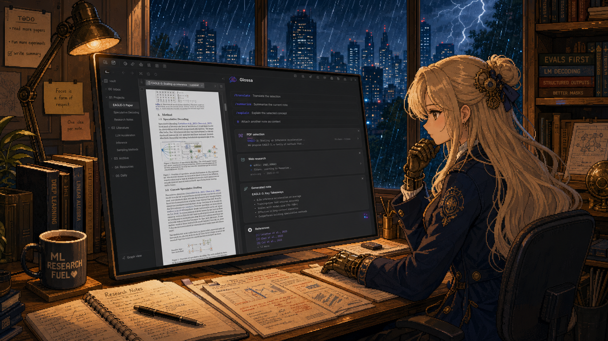
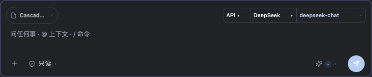

<div align="center">

# Glossa

### 理解你的知识库，也尊重每一次修改。

一个本地优先的 AI 工作侧栏：阅读真实笔记、研究公开资料、处理 PDF 与图片，并在清楚可见的审批下修改文件。

[](https://obsidian.md/plugins?id=glossa)
[](https://github.com/yiiwang118/obsidian-glossa/releases/latest)
[](https://github.com/yiiwang118/obsidian-glossa/actions/workflows/ci.yml)
[](LICENSE)

[English](README.md) · [最新版本](https://github.com/yiiwang118/obsidian-glossa/releases/latest) · [更新记录](CHANGELOG.md)



</div>

Glossa 不是一个和笔记割裂的聊天框，而是一块真正能工作的侧栏。当前笔记可以自然进入上下文；你明确附加的文件会保持为任务目标；API 模式的文件修改经过可见工具、权限判断和审批流程，可选的本机 CLI 则使用下文说明的原生权限边界。

[安装](#安装) · [快速开始](#一分钟开始) · [后台会话](#会话整理与后台运行) · [模型与 CLI](#模型思考强度与本机-cli) · [升级指南](#升级与本地历史) · [隐私说明](PRIVACY.md)

## Glossa 能做什么

| | 能力 | 实际体验 |
|---|---|---|
| 🧠 | **理解上下文** | 直接处理当前笔记、选区、附件、PDF、图片和上一轮任务状态，不必反复复制内容。 |
| ✍️ | **精确修改文件** | 修改一个章节、替换精确文本、协调多文件变更，并保留无关 Markdown，而不是动不动重写全文。 |
| ⌨️ | **建议接下来怎么写** | 可选择在写作停顿时请求有边界、低延迟的 Markdown 续写，并直接在编辑器中接受灰色建议。 |
| 📚 | **认真阅读文档** | 按页理解论文、搜索 PDF 正文、渲染视觉页面，并对截图执行 OCR、图表分析和 UI 细节检查。 |
| 🌐 | **研究公开资料** | 有边界地搜索和提取网页，核对论文身份，验证下载内容，并保存带来源信息的真实文件。 |
| 🧩 | **运行聚焦 Skills** | 使用 Markdown、Canvas、Bases、PDF、图片工作流，也可以创建并校验自己的 Vault Skill。 |
| 🔐 | **让操作可追踪** | 从只读开始，逐项审批写入，查看工具结果，并在修改不合适时恢复 checkpoint。 |

## 临时聊天

想就回答里的某一段追问，又不想把问题加进主对话时，可以用临时聊天。在对话中选中文字，右键选择 **添加到临时聊天**；也可以点消息下方的气泡加号，有选区时引用选区，没有选区时引用整条消息。命令面板中的 **Glossa: Open temporary chat** 可以重新打开。

- 在约 560 × 740 的独立窗口中打开，不挤占主侧栏；无法弹出窗口时改用标签页。每个主聊有自己的临时聊天，之后从同一主聊引用的内容会加入同一个窗口。
- 窗口里只有引用、对话和输入框。**保存为笔记** 和 **清空** 在窗口标题栏；标题栏的 **⋯** 菜单还可以打开来源主聊，有多个 API 端点时也在这里切换模型。
- 引用以单行形式停在输入框上方（点一下可展开全文），提问后随这一问保留。公式以 LaTeX 原文引用，代码、列表和表格保留 Markdown 结构；整条选中时直接引用这条消息的原文。
- 每次提问只发送这一问的引用（被引用的回答会附上它所回答的提问）和这段临时聊天之前的问答，不会带上主聊的其他消息、笔记、附件、工具结果和思考内容。讨论很长、超出模型上下文时，最早的几轮会被省略，窗口里会用一条分隔线标出位置。
- 回答来自 **API 端点**：默认用主聊的模型；主聊用的是 Codex、Claude Code 或 Grok 时，改用第一个 API 端点。不运行工具，不读取库内文件，也不使用 CLI 会话。回答语言跟随提问，流式显示渲染后的 Markdown、公式和代码，模型的思考过程折叠显示。按 Esc 可停止生成；失败或停止的回复可以重试，最后一条回答可以重新生成；重新生成失败或被停止时保留之前完整的回答。
- 每条回答下方的 **放入主聊输入框** 会把这条回复放进来源主聊的输入框，必要时自动切回该主聊，不会自动发送。**保存为笔记** 会把这段讨论连同引用写成一篇 Markdown 笔记，保存在聊天文件夹中，保存内容固定为点击时的快照，并保留回复截断提示。
- 每次提问最多引用 8 段、合计 24,000 字符；单段超过 12,000 字符时会截断并提示。一段临时聊天最多 50 轮。
- 关闭窗口会停止正在生成的回复；已收到的内容和未发送的草稿会保留到 Obsidian 重启或 Glossa 被禁用为止。内容只在内存中，按保存的布局恢复出来的临时窗口会自动关闭。“临时”不代表 API 服务商不保留请求。

左侧提问定位条也会跟随当前阅读轮次；滚动到最后一轮的长回答底部时，高亮最后一个提问。Markdown 渲染、折叠和窗口大小变化后会重新计算位置。

## 开发构建中的 Agent 改进

以下功能随当前分支构建提供，最新已发布版本仍为 1.1.0。

- **运行中断可追踪**：每轮保存有序、有上限的状态事件。重新打开会话时保留已完成结果，未完成的操作标记为中断，不会自动重做文件写入。
- **Codex 原生会话**：在 Codex 端点的高级设置中开启 **Codex 原生会话**，通过 App Server 跨消息、跨重启继续同一线程，Glossa 的指令追加在 Codex 自带指令之后。历史被修改、会话被分叉，或工作目录、权限模式、Glossa 指令（例如日期变化、项目说明被修改）改变时建立新线程；聊天中的 **重置关联** 可解除绑定。此功能默认关闭，失败不自动重放任务，关闭后继续使用原有 CLI 方式。
- **技能文件操作评测**：在 **学习记录 → 技能草稿 → 文件操作测试** 中填写样例 Markdown 和预期完整内容。基线与候选各使用全新的临时文件，支持列出、读取、编辑、写入和重命名；`repeat: true` 检查重复执行。可以精确验证 YAML、双链及无关文件是否保留，预期答案不发送给模型。需要支持工具调用的 API，会产生多次模型调用；不覆盖 Obsidian 自动链接维护和其他插件。包含文件样例的技能，启用或恢复时必须同时通过文本和文件检查。
- **子任务进度与控制**：`context: fork` 技能显示状态、正在执行的工具、步数与最近输出。可以单独停止，或补充一条在下一模型步骤接收的指令。子任务继承父任务的 Plan/Act、工作目录范围与审批规则；停止不会撤销已完成的修改，重启后不会自动续跑。
- **可选的空闲压缩**：开启 **缓存窗口内空闲压缩**，并填写 API 服务商说明的 **提示词缓存时长（秒）**。成功轮次报告的输入达到 10 万 token 后，可在缓存临近过期时尝试一次摘要，并尽可能保留上一请求的前缀。输入中、有待发消息或任务运行时跳过；缓存时长未知、CLI 和附带最新用户图片的请求也跳过。会增加一次模型调用，不保证缓存命中、费用降低或摘要无损。原有手动及上下文压力压缩保留，支持撤销，并阻止旧摘要覆盖期间已修改的历史。

Codex 还会在自身目录保存原生会话。文件评测使用独立的 `.glossa/evaluations/` 临时目录，正常结束、失败或取消时清理本次目录；应用崩溃可能留下样例目录。存储和发送范围详见[隐私说明](PRIVACY.md)。

## 1.1.0 更新

[**1.1.0 — 2026 年 10 月 20 日**](https://github.com/yiiwang118/obsidian-glossa/releases/tag/1.1.0) 加入后台会话、分文件历史存储、文件夹操作和按模型适配的思考控制。

- **多个对话同时推进**：切换会话、新建对话或关闭侧栏后，已发送的任务继续运行。历史列表显示运行中、待审批状态，通知可直接打开对应会话。
- **历史记录单独保存**：每个会话独立写入、打开时加载，不再只保留最近 100 条。搜索使用问题与回答的有限预览，不把附件原文和选区混入搜索结果。
- **直接整理库内文件夹**：创建空文件夹、移动或重命名目录，将文件或整个目录移入 Obsidian 配置的废纸篓。符合条件的文本文件可从本轮变更中恢复。
- **思考参数随模型调整**：已识别的官方 API 模型显示对应的思考档位、开关与默认值；兼容网关保留灵活输入。OpenAI 兼容端点还可设置自动、固定或不发送温度。
- **更清楚的阅读体验**：更多界面文字跟随中英文语言设置，优化标题、段落和列表间距；开头的思考块单独展示，代码块使用 Obsidian 原生复制按钮。
- **并行任务互不串用授权**：技能授权按运行隔离，同一笔记的写入按顺序执行，停止任务会取消仍在排队的文件修改。



**运行要求**：桌面版 Obsidian **1.12.0 及以上**。已有模型接入与模型选择会保留。升级前请阅读[升级与本地历史](#升级与本地历史)，完整更新见 [Changelog](CHANGELOG.md#110--2026-10-20)。

## 安装

### 插件市场

打开 **设置 → 第三方插件 → 浏览**，搜索 **Glossa**，然后安装并启用。

[在插件市场打开 Glossa](https://obsidian.md/plugins?id=glossa)

### GitHub Release

从[最新版本](https://github.com/yiiwang118/obsidian-glossa/releases/latest)下载 `main.js`、`manifest.json` 和 `styles.css`，放入：

```text
<your-vault>/.obsidian/plugins/glossa/
```

重新加载应用，然后在第三方插件中启用 **Glossa**。

## 一分钟开始

1. 从左侧功能区或命令面板打开 Glossa。
2. 添加 OpenAI 兼容、Anthropic 兼容或本地 HTTP 模型端点。
3. 打开一篇笔记，用 `@` 附加文件，或选择一段文本。
4. 直接提问；只读任务保持 **Plan**，需要修改文件时切换到 **Act**。
5. 检查写入或下载请求的审批内容，再决定是否执行。

### 自定义 API 兼容性

Anthropic-style 端点可填写 SDK 根地址（如 `https://api.minimax.io/anthropic`）、以 `/v1` 结尾的版本根路径，或完整 Messages URL。设置中展示最终请求 URL；对话、连通测试和模型探测使用相同路径规则。OpenAI 兼容端点仍填写版本根路径。

在端点的 **高级 → 额外 JSON 请求体** 中填写 JSON 对象，例如 MiniMax OpenAI 格式使用 `{"reasoning_split":true}`，支持关闭思考的模型使用 `{"thinking":{"type":"disabled"}}`。显式参数在顶层覆盖自动生成值，包括思考、采样和 token 上限。模型、消息、system、工具、工具选择和流式字段不可覆盖。无效输入会显示错误且不保存；清空输入可移除覆盖。额外请求体按普通配置保存在插件设置中，凭据请使用 API key 字段。

思考选项随模型变化：“默认”由服务端决定，“关闭思考”仅在有对应关闭设置时出现。部分模型始终思考，或没有可调强度。翻译和自动补全会选择可用的最低思考设置，但不保证所有模型都能关闭思考。

快速翻译会为 MiniMax M2.x 设置 16,384 token 的输出上限，为思考预留空间。这是上限，不代表固定消耗或保证成功；额外请求体中显式指定的 token 上限优先。Anthropic 响应只有思考内容或被截断时会显示错误与重试按钮，不会标记为翻译完成。开启 Auto 后，每次新的有效选区都会发送到配置的翻译端点；关闭 Auto 可恢复手动触发。

## 会话整理与后台运行

- **整理历史**：在历史搜索框下点击 `+` 新建会话目录，再用对话右侧 `··· → 移动到目录` 归档。这些目录只用于整理对话，不会移动或删除库内笔记；删除目录会把对话保留在“未分类”。
- **并行运行**：发送后可以切换会话、新建对话或关闭 Glossa 面板，只要 Obsidian 与插件仍在运行，已有任务就会继续。历史列表展示运行和待审批状态，历史按钮显示后台任务数量。
- **回到原对话审批**：后台任务需要审批时会等待。点击通知或从历史中打开对应会话，确认具体操作；关闭面板不会自动批准请求。
- **补充与排队**：API 对话运行时按 Enter 默认补充到下一次模型请求；输入区菜单可改为下一轮排队，CLI 补充统一进入下一轮。最多保存 20 条待发送文字，可编辑或删除。已启用的队列在切换会话或关闭面板后继续；点击停止会结束续跑，重启 Obsidian 后需手动发送待处理消息。
- **持续任务**：顶部 `◎` 创建任务，再点击“继续”。默认最多 3 轮，可设置 1–20 轮；保存目标、进度和阻塞原因，并可在后台续跑。错误、阻塞或轮次上限会停止任务，重新载入的任务需明确恢复。该功能需要启用工具的 API 接入。
- **明确停止**：在对应对话中点击停止，会取消当前运行及后续排队或任务续跑；退出 Obsidian 或禁用插件也会停止运行。已经完成的文件修改仍会保留记录。
- **本地诊断**：从导出菜单下载最多 500 项元数据，包括模型、工具顺序、耗时和错误码；不含消息正文、笔记内容、工具参数、路径、端点 URL 或凭据，也不会自动上传。

## 模型、思考强度与本机 CLI

文件引用靠左，右侧紧凑选择器依次为 **API / CLI → 模型商或 CLI 软件 → 具体模型**。

| 控制项 | 使用方式 |
|---|---|
| API 接入 | 添加 OpenAI 兼容、Anthropic 兼容或本地 HTTP 端点，再选择模型。预设包含 Gemini、xAI、Z.ai、Kimi、MiniMax、OpenRouter 和 LM Studio。 |
| 思考强度 | 已识别的官方 API 模型显示对应档位、开关和默认值；模型没有可调选项时，会说明不可用原因。 |
| 兼容网关 | 第三方 API 提供灵活的 effort 选项与自定义输入，请使用该端点支持的值。 |
| 温度 | 在 OpenAI 兼容端点的 **高级 → 温度** 中，留空自动处理，输入 `off` 不发送参数，或输入 `0` 到 `2` 的固定值；模型自身的限制仍然适用。 |
| 本机 CLI | 选择 **Codex、Claude Code 或 Grok**，再选择模型和可用的 effort，也可使用自定义 effort。 |

先在终端安装并登录对应 CLI，Glossa 不负责安装、升级或登录。检测不到时，在模型接入设置中填写可执行文件路径。切换到 CLI 时读取原生模型和 effort 列表；切回 API 再回来会保留各提供方的选择。模型列表缓存 10 分钟，可在模型菜单中手动刷新，检索失败时保留上次结果。模型留空使用 CLI 默认配置；全局或端点代理会传入 CLI，插件不会读取 Shell 启动脚本。

CLI 仅适用于桌面文件系统库，在当前库目录运行。Codex 使用原生只读或工作区写入沙盒；Claude Code 需要支持 `--restricted` 的版本，开放 Read/Glob/Grep，允许写入的 Act 模式额外开放 Edit/Write。Codex 与 Claude Code 关闭外部 MCP 配置。Grok 需要支持 `streaming-messages-json`，请求原生只读或工作区沙盒，内置工具限于读取、搜索，Act 额外开放 `search_replace`，不开放内置 Shell 或子 Agent。三者均不启用权限绕过；CLI 自身配置、沙盒支持和服务条款仍适用，Grok 仍加载其本机配置。

**CLI 操作遵循 CLI 自身的权限。** 它们不经过 Glossa 的逐项审批、工作区子目录限制、技能学习或撤销检查点。重要文件请保留自己的版本历史。CLI 支持文字与笔记上下文，图片附件请使用 API；聊天记录仍可归档和导出。

## 库内文件与文件夹操作

API 模式下，阅读任务保持 **Plan**；需要修改文件时，选择 **Act** 并启用可写权限，然后明确描述操作，例如：

- “创建一个空的 `Research/Reading` 文件夹。”
- “把 `Inbox/Papers` 移动到 `Research/Papers`。”
- “把 `Drafts/Old` 以及其中的内容移入废纸篓。”

写入遵循已配置的审批规则。删除使用 Obsidian 设置的废纸篓，库根目录和配置目录受到保护。本轮文件变更会展示结果及符合条件的撤销操作。文本快照无法完整恢复移动、重命名和二进制文件，大批量操作也可能超出快照上限；无法撤销时，请使用文件恢复或自己的备份。

## 升级与本地历史

1. 通过 Obsidian 更新，或只用同一 Release 的 `main.js`、`manifest.json`、`styles.css` 替换插件文件，保留原有设置和历史数据。
2. 首次载入会将旧的单文件历史迁移到 `chats/<id>.json`，`chats.json` 保存目录、摘要和搜索预览。只有所有会话成功写入后才完成迁移；中途失败会保留旧存储并重试。
3. 迁移副本 `chats.v3-backup.json` 保留 30 天，在副本仍可用时可恢复缺失的会话文件。删除会话也会清理副本中的对应内容，清空所有会话会删除该副本。

数据位于配置的插件目录，通常为 `.obsidian/plugins/glossa/`。聊天正文、预览、待发送消息和任务状态都是**明文**，可能随笔记库同步；API 密钥加密不包含聊天历史。升级或降级前请保留独立备份，旧版本不识别新的分文件历史格式；迁移副本只是临时恢复措施。

## 技能学习

**从一次纠正中学习。** 点击助手回复旁的 **记住这次纠正**，将反馈整理成可编辑的技能草稿。可以新建技能，也可以选中已有学习技能继续改进。检查对话摘录与技能差异，再审阅生成的样例或添加自己的样例。每个样例使用独立上下文，分别运行候选版本与当前启用版本（尚无版本时不加载该技能），检查输出中的精确文本片段和触发范围。编辑草稿或样例会使验证结果失效，候选版本的全部样例通过后才能启用；通过率持平会明确显示“未显示提升”。

第一版验证的是 **文本行为**，不执行工具或修改真实笔记。生成草稿使用当前聊天模型；验证支持 3–5 个样例，每个样例调用模型两次。验收片段不会发送给被测模型。发送前可以编辑对话摘录，学习功能不会自动收集工具结果正文或附件内容。没有后台训练或模型权重更新。

通过 **Glossa: Manage learned skills** 命令或弹窗中的 **学习记录**，可以查看结果、停用技能、编辑草稿，或恢复通过过验证的历史版本。启用的技能会加入后续对话的技能发现流程，沿用原有工具审批规则，不覆盖内置或手写技能。草稿、技能版本、反馈来源、模型信息和验证输出保存在当前库的 `.glossa/learning.json`，最多保存 60 个学习技能，每个技能保留 12 个版本。学习记录是明文文件，可能随笔记库同步；API 密钥加密不包含该文件。保存时会检查其他窗口的修改，历史验证结果仅代表当时使用的模型与样例。

## 账号、联网与本地文件

Glossa 免费使用，不需要 Glossa 账号。云端模型或搜索服务可能需要其自身账号、API key、订阅或按量付费，相关费用由服务商收取；也可以配置本地 HTTP 模型服务。

- 聊天、翻译、补全和技能验证会将提示词及相关上下文发送到你配置的模型服务；自动翻译、自动补全需要主动开启。本机 CLI 使用它自己的登录与服务配置，切换或刷新 CLI 时会读取模型能力信息。
- 网页搜索使用 DuckDuckGo，或你选择的 Brave、Tavily、Exa、SerpAPI；论文检索与下载候选发现会将检索词或论文标题发送给 OpenAlex、arXiv、DuckDuckGo、Yahoo；项目检索会使用 GitHub 搜索 API。网页读取和下载会请求目标公共网站。网络工具遵循审批及用户设置的自动批准规则。
- 版本检查只向本项目的 GitHub releases API 请求版本信息，不发送笔记内容或模型密钥。默认开启，每 12 小时最多自动检查一次，可以关闭；更新通过 Obsidian 安装。
- 本机 CLI 会访问 vault 外已安装的可执行文件，并使用用户主目录定位常见安装路径。Grok 需要提示词文件，因此 Glossa 会将会话和所选上下文写入 **vault 外的系统临时目录** `glossa-grok-*`，POSIX 系统上文件仅限所有者读写，完成、失败或取消后删除；宿主异常退出可能留下临时文件。Codex、Claude Code 通过标准输入接收提示词。Glossa 不读取 CLI 凭据文件，CLI 本身的登录、配置和数据保留策略仍然适用。

## 典型工作流

```text
打开一篇论文
  -> 询问方法或某张图
  -> Glossa 自动选择文本页或视觉证据
  -> 回答保持在具体页面内容上
```

```text
给出公开论文标题和 Vault 目录
  -> 有边界地发现来源
  -> 核对标题与响应内容
  -> 保存真实 PDF
  -> 继续读取下载后的论文
```

```text
要求修改一篇笔记
  -> 只读取相关内容
  -> 预览并审批修改
  -> 写入最小 patch
  -> 重新检查变更区域
```

## 自然工作的上下文

- 发送请求时会刷新当前 Markdown 正文，不使用过时快照。
- 明确附加的文件或选区会成为“这个文件”“这篇论文”的优先指代对象。
- 来源语言和回答语言相互独立，英文论文不会覆盖用户的中文表达习惯。
- 长对话保留最近证据，压缩较早工具结果，同时保存用户纠正、URL、路径、失败原因和下一步。
- 聊天落盘时会移除重复图片数据和仅供模型使用的上下文，保留有用文本与元数据。

## 安全边界

- **Plan 模式与只读权限** 是新安装的保守起点。
- **写入审批** 可以按工具、路径、目录或会话设置。
- **Checkpoint** 会在破坏性修改前保存受影响文件的快照。
- **删除和移动** 文件或整个文件夹遵循已配置的审批规则；删除的内容进入 Obsidian 设置的废纸篓，库的根目录和配置文件夹不会被删除或移动。
- **网络工具** 对响应大小、跳转、私网地址和下载意图设置明确边界。
- **下载验证** 会在写入前检查大小、响应状态和文件签名。
- **API 模式** 使用库内工具和 Glossa 审批；**CLI 模式** 显式启动本机程序，遵循上文单独说明的权限边界。

Glossa 本身不是托管 AI 服务。对话与选定上下文会发送到你配置的模型端点；网页只会在执行对应网络任务时访问。完整边界见[隐私政策](PRIVACY.md)和[安全说明](SECURITY.md)。

## 构建与验证

```bash
git clone https://github.com/yiiwang118/obsidian-glossa.git
cd obsidian-glossa
npm ci
npm run check
```

`npm run check` 会依次运行 TypeScript、review lint、strict lint、禁用指令审计、独立社区扫描配置检查、完整测试、依赖审计、生产构建、生成 bundle 扫描和发布元数据检查。

开发构建可以直接同步到指定 Vault：

```bash
GLOSSA_PLUGIN_DIR="/path/to/vault/.obsidian/plugins/glossa" npm run dev
```

## 项目说明

- 当前版本仅支持桌面端。
- 支持应用 1.12.0 及以上版本；在 1.13 及以上版本中会自动接入设置搜索。
- 新安装默认使用 Plan 模式和只读权限。
- Release 资产由 GitHub Actions 重新构建并验证后发布。
- 欢迎提交 issue 和可稳定复现的 bug report。
- 本开源项目认可并链接 [LINUX DO 社区](https://linux.do/)。

## License

[MIT](LICENSE) © yiiwang
